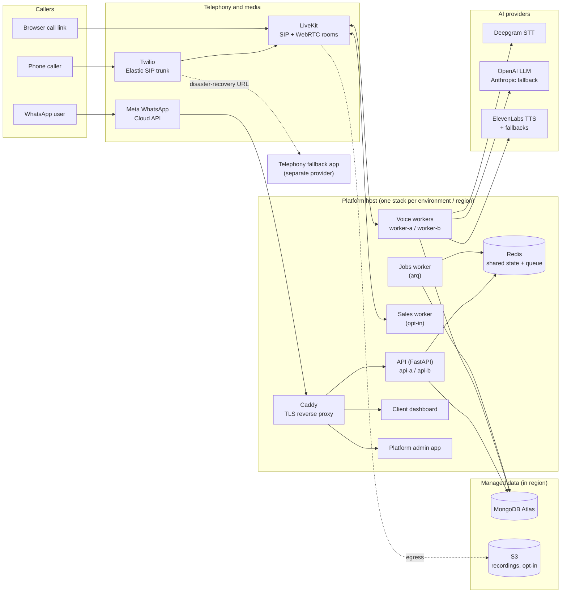

<div align="center">

# LaudLine

**A multi-tenant, real-time AI voice receptionist for local businesses.**
It answers the phone, books appointments, triages urgent calls, qualifies leads and hands off to a person, all on the business's own number.

[](https://github.com/weblaud-us/ai-receptionist/actions/workflows/ci.yml)
[](https://github.com/weblaud-us/ai-receptionist/actions/workflows/deploy.yml)


[Overview](#overview) ·
[Architecture](#architecture) ·
[Quick start](#quick-start) ·
[Testing](#testing-and-quality-gates) ·
[Deployment](#deployment) ·
[Security](#security) ·
[Docs](#documentation)

</div>

---

## Table of contents

- [Overview](#overview)
- [Key capabilities](#key-capabilities)
- [Architecture](#architecture)
- [Repository layout](#repository-layout)
- [Technology stack](#technology-stack)
- [Quick start](#quick-start)
- [Configuration](#configuration)
- [Testing and quality gates](#testing-and-quality-gates)
- [CI/CD and releases](#cicd-and-releases)
- [Deployment](#deployment)
- [Observability](#observability)
- [Security](#security)
- [Compliance and data protection](#compliance-and-data-protection)
- [Documentation](#documentation)
- [Contributing](#contributing)
- [License](#license)

---

## Overview

LaudLine is a SaaS platform that gives every business its own AI phone receptionist. Each
business (a **tenant**) has its own phone numbers, opening hours, services, staff, knowledge base,
voice and rules. The same platform serves salons, home services, restaurants, clinics, professional
offices, hotels and dental practices through vertical templates.

**Current go-to-market:** an overflow, lunch-break and after-hours receptionist for private and
mixed dental practices in **Australia** (first) and the **United Kingdom**. It books into
Cliniko or Dentally, triages dental emergencies, qualifies implant and cosmetic leads, and keeps
health data in the practice's own country.

The monorepo contains:

| Component | Path | Audience |
|---|---|---|
| **Backend**: API, voice agent, job worker, outbound sales agent | [`AI-receptionist-1/`](AI-receptionist-1/) | Callers, integrations |
| **Client dashboard** | [`dashboard/`](dashboard/) | Business owners and staff |
| **Platform admin app** | [`platform-dashboard/`](platform-dashboard/) | Platform operators (MFA required) |
| **Landing page** | [`landing-page/`](landing-page/) | Prospective customers (AU / UK) |
| **Shared frontend package** | [`packages/shared/`](packages/shared/) | Both dashboards |
| **Infrastructure** | [`deploy/`](deploy/), [`.github/workflows/`](.github/workflows/) | Operators |
| **Documentation** | [`docs/`](docs/) | Everyone |

---

## Key capabilities

### Real-time voice

- **One voice agent** for phone (SIP) and browser (WebRTC) calls, built on LiveKit Agents.
- **Streaming pipeline:** Deepgram Nova-3 STT → LLM (OpenAI, with an Anthropic fallback) →
  ElevenLabs Flash TTS (with Cartesia, Deepgram, Kokoro and OpenAI fallbacks).
- **Natural turn-taking:** LiveKit turn detector, Silero VAD, barge-in with false-interruption
  resume, telephony noise cancellation, pre-rendered greetings, preemptive generation.
- **Latency targets:** p50 ≤ 1.0 s, p95 ≤ 1.8 s, tool turns ≤ 1.6 s, greeting ≤ 0.7 s. Every turn's
  latency is stored and reported (`scripts/latency_report`).
- **Never traps a caller:** saying "agent" or pressing **0** transfers to a person (SIP REFER) or
  takes a message.

### Channels

| Channel | Path |
|---|---|
| Phone | Twilio number → Elastic SIP trunk → LiveKit → voice worker |
| Browser call | Signed, expiring link (`/call/{room}`) → LiveKit room → same voice worker |
| WhatsApp | Meta Cloud API → text and voice notes, replies by text or audio |
| SMS | Notifications, missed-call text-back, STOP / START / HELP handling |

### Business operations

- **Scheduling:** a DST-safe availability engine with database-level double-booking protection,
  plus two-way **Google Calendar** sync.
- **Practice management systems:** **Cliniko** (AU / UK shards) and **Dentally** (early access) as
  external systems of record.
- **Vertical templates** for prompts, tools, labels and defaults: `dental`, `clinic`, `salon`,
  `home_services`, `restaurant`, `hotel`, `professional` and `generic`.
- **Dental vertical:** emergency triage with red-flag escalation (000 / 999 / NHS 111), implant
  and cosmetic lead qualification with estimated lead value, NHS and private handling, lunch-break
  and overflow greetings, missed-call recovery, patient reactivation and an ROI dashboard.
- **Knowledge base:** website import, Q&A editor and an unanswered-questions queue.
- **Notifications and webhooks:** owner alerts by SMS, e-mail (Resend) and WhatsApp, daily digests,
  appointment reminders and signed outgoing webhooks.

### Platform

- **Multi-tenancy:** every record carries a `tenant_id`; data access goes through tenant-scoped
  repositories, enforced by an automated isolation guard in the test suite.
- **Identity:** argon2id passwords, owner / admin / staff roles, rotating httpOnly refresh cookies,
  TOTP two-factor (mandatory for platform admins), audited impersonation.
- **Billing:** Stripe subscriptions, trials, setup fees, metered overage and per-plan limits in USD,
  GBP, EUR and AUD.
- **Self-serve onboarding:** signup, onboarding wizard and number provisioning, including AU and UK
  regulatory bundles.
- **Outbound sales dialer** (off by default): campaigns, CSV lead import, a compliance gate
  (calling hours, DNC registries, line-type checks, blocked jurisdictions), automated opt-out, and
  live listen-in or takeover from the platform app.
- **Pilots and launch tooling:** results reports, transcript review that produces redacted eval
  cases, and unit-economics views.

---

## Architecture



### Runtime processes

All backend processes are built from one [Dockerfile](AI-receptionist-1/Dockerfile), one target
each. They share their image layers and run as a non-root user (UID 10001).

| Process | Image target | Role | Scales by |
|---|---|---|---|
| `api` | `api` | Webhooks, dashboard and platform APIs, call page, health and metrics | Replicas (state lives in Redis) |
| `worker` | `worker` | LiveKit voice agent; one job per call; drains live calls on SIGTERM | Replicas (2–4 per host) or LiveKit Cloud Agents |
| `jobs` | `jobs` | arq queue: reminders, digests, calendar and PMS sync, WhatsApp replies, retention, billing ticks | Single instance |
| `sales-worker` | `worker` | Outbound sales agent; only with the `dialer` profile and `OUTBOUND_DIALER_ENABLED=true` | Single instance |
| `fallback_app` | `api` | Twilio disaster-recovery TwiML on a **separate provider**; rings the business when the main stack is unreachable | Independent |

### Life of an inbound call

1. A caller dials a business number. Twilio routes the call over the Elastic SIP trunk to a
   LiveKit inbound trunk, and a dispatch rule assigns the room to a voice worker.
2. The worker resolves the tenant from the dialled number and plays a pre-rendered greeting that
   says the assistant is an AI (and announces recording when it is on). The caller's history
   loads while the greeting plays.
3. Speech streams through STT → LLM → TTS. The LLM sees a prompt built from the tenant's vertical
   template, facts and knowledge, and can call only the tools registered for that vertical.
4. Tools check availability, book, reschedule or cancel (built-in scheduler, Cliniko or Dentally),
   capture leads, triage emergencies, send links, take messages, transfer or end the call. Each
   tool makes at most two round trips and has a hard timeout.
5. When the call ends, the transcript, outcome and per-turn latency are saved. The jobs worker
   sends owner notifications, webhooks, reminders and digests.
6. If LiveKit or the whole host is unreachable, Twilio calls the disaster-recovery URL, and the
   fallback app forwards the call to the business's staff number.

---

## Repository layout

```text
.
├── AI-receptionist-1/          Backend (Python 3.12, uv)
│   ├── main.py                 FastAPI app, middleware, health endpoints
│   ├── config.py               Every setting + production safety guard
│   ├── agent/                  LiveKit voice agent (inbound) and outbound sales agent
│   ├── core/                   Framework-light domain logic
│   │   ├── tenancy/            Tenant model and resolver (number / WhatsApp id → tenant)
│   │   ├── repositories/       Tenant-scoped data access
│   │   ├── auth/               Users, roles, tokens, TOTP
│   │   ├── prompts/            Prompt builder + vertical templates
│   │   ├── tools/              AI tools shared by voice and WhatsApp
│   │   ├── services/           Availability, scheduling, PMS and calendar sync, insights
│   │   ├── integrations/       Twilio, Meta, Cliniko, Dentally, Google, S3, SMS, e-mail, webhooks
│   │   ├── billing/            Plans, Stripe, metering, usage gates
│   │   ├── compliance/         Legal versions, opt-outs, data subject requests, retention
│   │   └── outbound/           Dialer, compliance gate, DNC, sales persona
│   ├── routers/                HTTP routes (/auth, /t, /platform, /signup, /telephony, …)
│   ├── jobs/                   arq worker (python -m jobs)
│   ├── migrations/             Idempotent data migrations and index creation
│   ├── scripts/                Operator tools (check_env, latency_report, synthetic_call, …)
│   ├── telephony/              LiveKit SIP trunk and dispatch-rule templates
│   ├── tests/                  pytest suite + real-LLM conversation evals
│   └── Dockerfile              Targets: api, worker, jobs, dev
├── dashboard/                  Client dashboard (React 19, Vite, Tailwind v4)
├── platform-dashboard/         Platform admin app (React 19, Vite, LiveKit client)
├── landing-page/               Marketing site (Astro, static, AU and UK)
├── packages/shared/            Shared UI kit, API client, auth (source-only)
├── deploy/                     Production compose, Caddy, deploy script, monitoring, regions
├── docs/                       Architecture, runbook, compliance, legal drafts, testing guides
├── .github/                    CI, deploy workflows, Dependabot
├── docker-compose.yml          Full local stack
├── Makefile                    make dev | test | logs | images | down
└── package.json                npm workspaces root
```

---

## Technology stack

| Layer | Technology |
|---|---|
| **API** | Python 3.12, FastAPI, Uvicorn, Pydantic v2, pydantic-settings |
| **Voice** | LiveKit Agents 1.8 (SIP + WebRTC), Silero VAD, LiveKit turn detector, BVC telephony noise cancellation |
| **Speech and language** | Deepgram (STT), OpenAI (LLM, STT fallback), Anthropic (LLM fallback), ElevenLabs, Cartesia, Deepgram Aura (TTS) |
| **Telephony and messaging** | Twilio (Elastic SIP, SMS, provisioning), Meta WhatsApp Cloud API, Resend (e-mail) |
| **Data** | MongoDB (Motor), Redis (rate limits, dedupe, counters, arq queue), S3-compatible storage |
| **Integrations** | Cliniko, Dentally, Google Calendar, Stripe |
| **Frontends** | React 19, TypeScript 6, Vite 8, Tailwind CSS v4, shadcn/ui (Base UI), TanStack Query, Recharts |
| **Landing page** | Astro 7, Tailwind CSS v4, self-hosted fonts, Nginx with a strict CSP |
| **Infrastructure** | Docker, Docker Compose, Caddy (automatic TLS), GitHub Actions, GHCR |
| **Observability** | Prometheus metrics and alert rules, Sentry, structured JSON logs with PII masking |
| **Tooling** | uv (locked Python deps), ruff, mypy, pytest, ESLint, npm workspaces, Dependabot, gitleaks, pip-audit |

---

## Quick start

### Prerequisites

| Tool | Version | Needed for |
|---|---|---|
| [Docker](https://docs.docker.com/get-docker/) + Compose | Recent | The full local stack (recommended path) |
| [uv](https://docs.astral.sh/uv/) | Recent | Running the backend outside Docker |
| [Node.js](https://nodejs.org/) | 22+ | Running the frontends outside Docker |
| LiveKit project, OpenAI key | — | Live voice calls (a free LiveKit dev project is enough) |

### 1. Configure

```bash
git clone https://github.com/weblaud-us/ai-receptionist.git
cd ai-receptionist
cp AI-receptionist-1/.env.example AI-receptionist-1/.env
```

Fill in development values in `AI-receptionist-1/.env`. At minimum, set `APP_ENV=development`.
For voice calls, also set `LIVEKIT_URL`, `LIVEKIT_API_KEY`, `LIVEKIT_API_SECRET`, `OPENAI_API_KEY`
and `DEEPGRAM_API_KEY`.

### 2. Run the whole product

```bash
make dev                # or: npm run stack   (Windows without make)
```

| Service | URL |
|---|---|
| API | http://localhost:8002 (OpenAPI docs at `/docs` outside production) |
| Client dashboard | http://localhost:5173 |
| Platform admin app | http://localhost:5174 |
| Landing page (AU at `/`, UK at `/uk/`) | http://localhost:4321 |
| MongoDB / Redis | `localhost:27017` / `localhost:6379` |

Code is mounted into the containers, so the API, the voice worker, both dashboards and the landing page reload on save.

```bash
npm run stack:dialer    # also start the outbound sales worker (dials nothing until enabled)
make logs               # follow backend logs
make down               # stop everything (data volumes are kept)
```

### 3. Create your first admin and tenant

```bash
cd AI-receptionist-1
uv run python -m migrations.m0002_indexes                   # create indexes
uv run python -m scripts.create_admin --email you@example.com
```

Sign in to the platform admin app, provision a business, then use **Open** to manage it in the
client dashboard.

### 4. Make a test call

You don't need a phone number. Run `uv run python -m scripts.setup_telephony` and call from a
softphone (Linphone) in development, or open a signed browser call link. The full walkthrough is in
[docs/TELEPHONY_TESTING.md](docs/TELEPHONY_TESTING.md).

### Running outside Docker

```bash
# Backend
cd AI-receptionist-1
uv sync                                         # Python 3.12 + exact versions from uv.lock
uv run uvicorn main:app --reload --port 8002    # API
uv run python -m agent.worker dev               # voice worker (Linux / macOS)
uv run python -m jobs                           # job worker

# Frontends (always install from the repo root)
npm install
npm run dev               # client dashboard   :5173
npm run dev:platform      # platform admin     :5174
npm run dev:landing       # landing page       :4321
```

> [!NOTE]
> **Windows:** `livekit-agents` can't load its native libraries on some Windows builds. Run the voice
> worker in Docker (`docker compose -f AI-receptionist-1/docker-compose.dev.yml up --build agent`
> or `start.bat`). LiveKit-dependent tests skip themselves on Windows; CI runs them on Linux.

To receive Twilio and Meta webhooks locally, expose port 8002 through a tunnel (ngrok,
cloudflared) and set `WEBHOOK_BASE_URL` to its `https://` URL.

---

## Configuration

All backend settings live in [`config.py`](AI-receptionist-1/config.py) and are documented in
[`.env.example`](AI-receptionist-1/.env.example). **CI fails if any setting is missing from
`.env.example`.** Validate a filled-in environment (read-only pings to every provider) with:

```bash
uv run python -m scripts.check_env
```

### Production safety guard

With `APP_ENV=production`, the backend **refuses to start** when the configuration is unsafe. It
checks, among other things:

- `DEBUG` is off, and `SECRET_KEY` is non-default and at least 32 characters
- `CORS_ORIGINS` lists explicit origins (no `*`)
- Twilio signature checks are on, and `WEBHOOK_BASE_URL` is `https://`
- `META_APP_SECRET` is set whenever WhatsApp is on
- Recording storage credentials are set whenever recording is on
- A Fernet `TOKEN_ENCRYPTION_KEY` is set whenever Google Calendar is configured
- Platform-admin MFA is required
- Vendor training opt-outs are on (`DEEPGRAM_MIP_OPT_OUT`, `OPENAI_STORE=false`)

### Feature flags

Paid and outward-facing features are **off by default** and switched on per environment:

| Flag | Enables |
|---|---|
| `SIGNUP_ENABLED` | Public self-serve signup |
| `NUMBER_PROVISIONING_ENABLED` | Buying and assigning Twilio numbers |
| `OUTBOUND_DIALER_ENABLED` | The outbound sales dialer (master switch) |
| `ENABLE_CALL_RECORDING` | Call recording through LiveKit Egress to S3 (always announced) |
| `PMS_DENTALLY_ENABLED` | Dentally integration (early access) |

### Frontend configuration

Frontends use build-time `VITE_*` variables (see each app's `.env.example`). Vite bakes them into
the bundle, so CI builds the dashboards **per environment**.

---

## Testing and quality gates

| What | Command | Needs |
|---|---|---|
| Backend tests (~575) | `cd AI-receptionist-1 && uv run pytest` | Nothing (in-memory MongoDB and Redis, no network) |
| Lint | `uv run ruff check .` | — |
| Type check | `uv run mypy` | — |
| All of the above, on Linux | `make test` | Docker |
| Frontends | `npm ci && npm run lint && npm run typecheck:shared && npm run build` | Node 22 |
| Conversation evals | `RUN_EVALS=1 uv run pytest tests/evals` | A real OpenAI key (a few cents) |
| Latency report | `uv run python -m scripts.latency_report --channel phone` | Calls in the database |
| Synthetic call / load test | `uv run python -m scripts.synthetic_call --tenant <id>` | LiveKit and a running worker |

**Conversation evals** run scripted calls against the real LLM (both the primary and the
fallback model) to check behaviour such as emergency escalation, price guardrails, opt-out
handling and NHS-to-private pivots. Run them whenever you change a prompt, model or tool.

Full guide: [TESTING.md](TESTING.md). Per-phase acceptance checks: [`docs/PHASE_*_TESTING.md`](docs/).

---

## CI/CD and releases

### Continuous integration

[`ci.yml`](.github/workflows/ci.yml) runs on every pull request and every push to `main`:

| Job | Checks |
|---|---|
| **backend** | `uv sync --frozen`, ruff, mypy, pytest, and that `.env.example` documents every setting |
| **evals** | Voice-agent evals on the primary and fallback LLMs (when the eval API keys are configured) |
| **frontends** | Lint, shared type check, production builds; landing-page prices match `plans.py`; WCAG AA colour contrast; no platform-admin code in the client bundle |
| **security** | `pip-audit` on locked Python deps, `npm audit` (high and above), gitleaks secret scan |
| **containers** | Builds every image, checks they run as non-root and import cleanly, validates every compose file |

Dependabot opens weekly PRs for Python and npm dependencies and monthly PRs for Actions and Docker
base images. The `livekit-agents` family is pinned together and upgraded by hand.

### Releases

Releases are **git tags**. [`deploy.yml`](.github/workflows/deploy.yml) re-runs CI, builds and
pushes images to GHCR, and rolls them out over SSH:

```bash
git tag v1.4.0-rc.1 && git push origin v1.4.0-rc.1    # → staging only
git tag v1.4.0      && git push origin v1.4.0         # → staging, then production
```

- Production deploys only final tags (no `-rc`), only after staging succeeds, and behind a required
  reviewer on the `production` GitHub environment.
- **Rollback:** Actions → *deploy* → *Run workflow* with the previous tag, or on the host
  `bash deploy/deploy.sh <tag> <environment>`. Dependencies are locked, so a rebuilt tag is
  identical.

---

## Deployment

Each environment is a single Docker host running
[`deploy/docker-compose.prod.yml`](deploy/docker-compose.prod.yml) behind Caddy (automatic TLS),
with MongoDB on Atlas and media and SIP on LiveKit Cloud.

- **Zero-downtime deploys:** `api-a`/`api-b` and `worker-a`/`worker-b` update one at a time. A
  worker being replaced stops taking new calls and finishes its live calls (up to
  `LIVEKIT_DRAIN_TIMEOUT`, 15 minutes by default) while its twin answers new ones.
- **Capacity:** set `WORKERS=3` or `4` per host. Beyond one host, move the `worker` image to LiveKit
  Cloud Agents or another platform that autoscales; the image only makes outbound connections.
- **Independent telephony fallback:** `fallback_app.py` runs on a second provider as Twilio's
  disaster-recovery URL, so calls still reach staff when the main host is down.

### Regional data residency

Dental call data is health data. Each country gets its own stack, so the database, recordings and
Redis stay in that country's AWS region:

| Stack | Environment | Region | Twilio edge / region | Cliniko shard |
|---|---|---|---|---|
| Australia | `production-au` | `ap-southeast-2` (Sydney) | `sydney` / `au1` | `au1`, `au2` |
| United Kingdom | `production-uk` | `eu-west-2` (London) | `dublin` / `ie1` | `uk1` |

`deploy.sh` refuses to deploy when the environment, its settings file and `DEPLOYMENT_REGION`
disagree. Speech and language models run where each vendor hosts them; the regional stack keeps
**stored** data local.

Host setup, secrets layout, DNS, the landing page and regional runbooks: [deploy/README.md](deploy/README.md).
Pre-launch checklist: [docs/PRODUCTION_CHECKLIST.md](docs/PRODUCTION_CHECKLIST.md).

---

## Observability

| Signal | Where |
|---|---|
| Liveness | `GET /livez` |
| Readiness | `GET /readyz` returns **503** when MongoDB or Redis is unreachable within 1 s (`/health` is an alias) |
| Metrics | `GET /metrics` (Prometheus, Bearer `METRICS_TOKEN`); HTTP, call outcomes, latency and provider health. Voice workers expose their own port |
| Alerts | [`deploy/monitoring/alerts.yml`](deploy/monitoring/alerts.yml): response latency, slow greetings, provider errors, fallback in use, failing transfers, busy-line refusals, API down or 5xx, dead jobs, worker down, outbound opt-out spikes |
| Errors | Sentry for the backend and both dashboards, tagged with the release's git SHA |
| Logs | JSON on stdout with request and call IDs. Phone numbers and e-mails are masked, and transcripts are never logged in production |
| Dead jobs | `python -m jobs dead` |

Incident procedures: [docs/RUNBOOK.md](docs/RUNBOOK.md).

---

## Security

Highlights (full customer-facing summary in [docs/legal/SECURITY.md](docs/legal/SECURITY.md)):

- **Tenant isolation:** every query is scoped by `tenant_id` through `core/repositories`. A guard
  test fails the build if code reads tenant data any other way, and API tests prove no endpoint or
  tool leaks across tenants.
- **Signed webhooks:** Twilio (`X-Twilio-Signature`), Meta (`X-Hub-Signature-256`) and Stripe.
  Unsigned requests get 403.
- **Signed, expiring links** for browser calls and LiveKit tokens (15 minutes).
- **Caller verification:** booking tools only return or change a booking when the caller's number
  matches it, or the caller gives the booking reference together with a matching name or date.
- **Encryption:** TLS in transit; Fernet field encryption for OAuth tokens, 2FA secrets and identity
  numbers, and for call transcripts and clinical notes at dental practices (or any business that
  turns clinical encryption on); provider-managed encryption at rest.
- **Access control:** argon2id, short-lived access tokens, rotating httpOnly refresh cookies, roles,
  mandatory TOTP for platform admins, and an audit log the business can see.
- **Abuse protection:** per-IP and per-tenant rate limits, plus per-tenant concurrent-call limits.
- **Supply chain:** exactly pinned and locked dependencies, Dependabot, pip-audit, npm audit and
  gitleaks in CI. Containers run as non-root.

### Reporting a vulnerability

Please **do not open a public issue.** Report vulnerabilities privately to the maintainers, with
steps to reproduce and the affected component. We aim to acknowledge reports promptly and will keep
you informed until the issue is resolved.

---

## Compliance and data protection

The product enforces these controls today (details and open legal items in
[docs/COMPLIANCE.md](docs/COMPLIANCE.md)):

| Control | Implementation |
|---|---|
| **AI disclosure** | Every greeting names the assistant as an AI, and it answers honestly whenever asked |
| **Recording notice** | Announced first whenever recording is on; recording is never silent |
| **Retention** | Per-tenant transcript (90 days by default) and recording (30 days) retention, enforced by scheduled jobs; all data deleted 30 days after cancellation |
| **Data subject requests** | Find, export or erase everything for a phone number, with due-date tracking |
| **Consent revocation** | STOP over SMS, WhatsApp or voice recorded centrally; contacts marked do-not-contact |
| **No vendor training** | `OPENAI_STORE=false` and the Deepgram model-improvement opt-out, both enforced by the production guard |
| **Emergency safety** | Never presented as an emergency service; local emergency numbers come from code, not the model |
| **Outbound calling** | Calling-hours rules by local time, DNC registries with freshness checks, line-type checks, blocked jurisdictions and an automated in-call opt-out |
| **Agreements** | Versioned Terms, Privacy Policy, AUP and DPA, with acceptance recorded per user and per business |

> [!IMPORTANT]
> The platform is **not** HIPAA-compliant and holds **no** SOC 2 or ISO 27001 certification.
> Zero Data Retention is not claimed until each vendor approves it (`OPENAI_ZDR_ENABLED`,
> `DEEPGRAM_ZDR_ENABLED`). The drafts in [`docs/legal/`](docs/legal/) need counsel review before use.

---

## Documentation

| Topic | Document |
|---|---|
| Backend internals and layout | [AI-receptionist-1/README.md](AI-receptionist-1/README.md) |
| Testing guide | [TESTING.md](TESTING.md) |
| Telephony setup and test calls | [docs/TELEPHONY_TESTING.md](docs/TELEPHONY_TESTING.md), [AI-receptionist-1/telephony/README.md](AI-receptionist-1/telephony/README.md) |
| Deployment and regional stacks | [deploy/README.md](deploy/README.md) |
| Production checklist | [docs/PRODUCTION_CHECKLIST.md](docs/PRODUCTION_CHECKLIST.md) |
| Launch checklist | [docs/LAUNCH_CHECKLIST.md](docs/LAUNCH_CHECKLIST.md) |
| Incident runbook | [docs/RUNBOOK.md](docs/RUNBOOK.md) |
| Compliance | [docs/COMPLIANCE.md](docs/COMPLIANCE.md) |
| Legal drafts (Terms, Privacy, DPA, AUP, SLA, sub-processors, security) | [docs/legal/](docs/legal/) |
| Customer help centre (also shown in-app under Help → Guides) | [packages/shared/src/help/](packages/shared/src/help/) |
| Support, pilots and sales | [docs/SUPPORT.md](docs/SUPPORT.md), [docs/PILOT_PLAYBOOK.md](docs/PILOT_PLAYBOOK.md), [docs/SALES_PLAYBOOK.md](docs/SALES_PLAYBOOK.md) |
| Product roadmap (Phases 0–7) | [ROADMAP.md](ROADMAP.md), [ROADMAP_PLAN.md](ROADMAP_PLAN.md) |
| Dental vertical plan | [DENTAL_ROADMAP.md](DENTAL_ROADMAP.md) |
| Frontends | [dashboard/](dashboard/README.md), [platform-dashboard/](platform-dashboard/README.md), [landing-page/](landing-page/README.md), [packages/shared/](packages/shared/README.md) |
| Historical backend map (pre-Phase 0) | [docs/ARCHITECTURE.md](docs/ARCHITECTURE.md) |

---

## Contributing

1. Branch from `main`; never push directly to it.
2. Before pushing, make sure these pass locally (CI enforces the same):
   ```bash
   make test                                                     # backend: ruff, mypy, pytest
   npm run lint && npm run typecheck:shared && npm run build     # frontends
   ```
3. If you changed a prompt, model or tool, run the conversation evals.
4. Open a pull request with a clear description and a test plan.

### Engineering conventions

- **Tenant data goes through `core/repositories`.** The isolation guard test rejects anything else.
- **New settings** go in `config.py` *and* `.env.example`, and in the production guard if unsafe
  values are possible.
- **Dependencies are pinned exactly.** Change a pin, run `uv lock`, run the tests and commit both
  files. Upgrade the `livekit-agents` family together, on purpose.
- **Prices** change in `core/billing/plans.py` and `landing-page/src/data/plans.ts` together; CI
  checks they match.
- **Frontend packages** install from the repo root only. Inside `packages/shared`, use relative
  imports, never `@/`.
- **Product claims** (landing page, help centre, legal) must describe only what the code does today.
  See the copy rules in [landing-page/README.md](landing-page/README.md).
- **Secrets are never committed.** gitleaks scans every PR; anything that leaks must be rotated, not
  just deleted.

---

## License

**Proprietary.** Copyright © 2026 WEBLAUD LLC. All rights reserved.

This repository and its contents are confidential. No part of it may be copied, modified,
distributed or used without prior written permission from WEBLAUD LLC.
