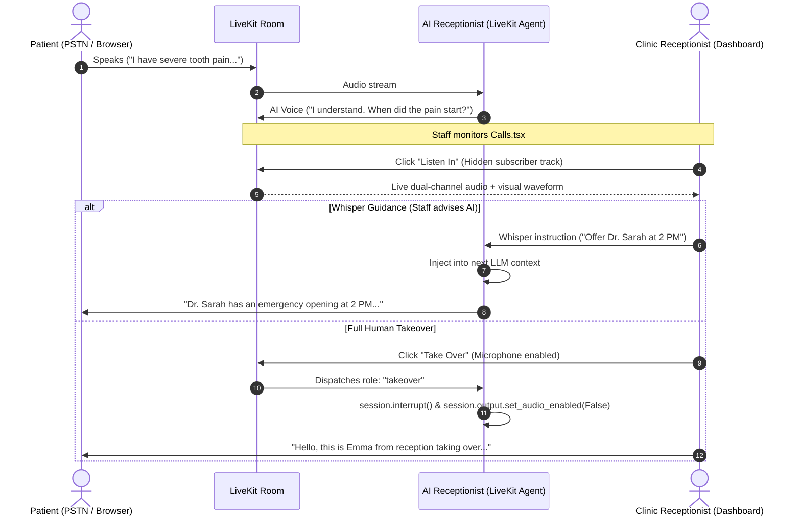
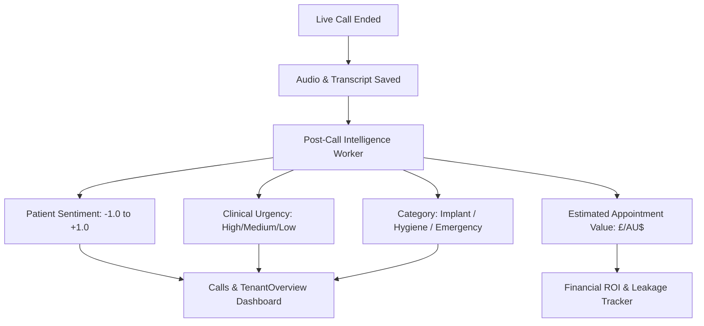

# Enterprise Product Upgrade Plan: Vapi & Retell AI Benchmark
**System:** WebLaud AI Receptionist (Private & Cosmetic/Implant Dental AU/UK)  
**Standard:** Enterprise Voice AI & Telephony (Vapi / Retell AI Feature Parity & Superiority)  
**Deliverable Type:** Architectural & Implementation Plan (`/plan`)  
**Status:** Pending User Approval  

---

## 1. Executive Benchmark: Bridging the Gap to Retell AI & Vapi

Industry leaders like **Retell AI** and **Vapi** have established the gold standard for conversational voice AI across three dimensions:
1. **Perceptual Latency & Conversational Naturalness:** Turn latency under 600ms, human-like backchanneling ("mm-hmm", "sure", "got it"), dynamic endpointing that differentiates pauses from finished thoughts, and immediate verbal fillers during external API lookups to eliminate dead silence.
2. **Operator & Practice Manager Control:** Real-time visibility into active calls with streaming audio waveforms, live synchronized transcripts, and zero-latency human intercom tools (Listen In, Whisper Guidance to AI, Instant Takeover).
3. **Developer & Staff Testing Experience:** An in-dashboard playground that replicates production call conditions inside the browser with live latency waterfalls (VAD, STT, LLM TTFT, TTS), tool inspection, and voice persona tuning without opening new tabs.

### Comparative Feature Matrix

| Capability | Current WebLaud State | Retell AI / Vapi Standard | WebLaud Target State |
| :--- | :--- | :--- | :--- |
| **Live Call Monitoring** | Polling `/admin/calls/live` every 5s; text state badges only. | Sub-second WebSocket stream; visual audio waveform; streaming transcript. | **LiveKit Track Subscription** + WebSocket event bus + Canvas audio visualizer. |
| **Human Intercom & Takeover** | Present in platform dialer ([sales.py](file:///e:/WebLaud/Products/receptionist/AI-receptionist-1/routers/sales.py#L408-L421)); absent in tenant dashboard. | 1-click "Listen In" (silent), "Whisper" (staff to AI), and "Take Over" (mic on, AI silent). | **Dual-role LiveKit join** in tenant [Calls.tsx](file:///e:/WebLaud/Products/receptionist/dashboard/src/pages/Calls.tsx) (`listen`, `whisper`, `takeover`). |
| **Assistant Simulator** | External link to `call.html` via `useTestCall()`. | Embedded split-pane simulator with text/mic toggle, latency waterfalls, and tool logs. | **Embedded Playground** in [Assistant.tsx](file:///e:/WebLaud/Products/receptionist/dashboard/src/pages/Assistant.tsx) with WebRTC audio & live turn breakdown. |
| **Turn Responsiveness** | Static `min_delay` / `max_delay` in [session_factory.py](file:///e:/WebLaud/Products/receptionist/AI-receptionist-1/agent/session_factory.py#L168-L172). | Dynamic silence detection, adaptive interruption filtering, human backchanneling. | **Adaptive Turn Detection** + speech backchanneling ("Mm-hmm", "Right") during caller narration. |
| **PMS Lookup Latency UX** | Caller hears silence while Cliniko/Dentally API runs (800ms–2000ms). | Immediate conversational fillers ("Let me pull up Dr. Smith's calendar real quick..."). | **Immediate Verbal Fillers** triggered on tool invocation before awaiting network responses. |
| **Post-Call Intelligence** | Basic summary and outcome string in `calls.summary`. | Sentiment trajectory, booking conversion probability, missed revenue leakage. | **Structured Clinical Insights** with financial ROI tracking in [Calls.tsx](file:///e:/WebLaud/Products/receptionist/dashboard/src/pages/Calls.tsx) & [TenantOverview.tsx](file:///e:/WebLaud/Products/receptionist/dashboard/src/pages/TenantOverview.tsx). |
| **Appointment Pass** | SMS with plain text web link. | 1-click Apple Wallet / Google Calendar pass + interactive WhatsApp buttons. | **`.ics` Calendar Generator** + rich WhatsApp appointment cards with 1-click reschedule. |

---

## 2. Pillar 1: Staff Live Call Control Suite (Listen-in, Takeover & Whisper)



### 2.1 Backend Architecture
1. **Extend Tenant Live Token Endpoint:**
   - In [AI-receptionist-1/routers/tenant.py](file:///e:/WebLaud/Products/receptionist/AI-receptionist-1/routers/tenant.py) (or `routers/livekit.py`), expose:
     `POST /t/calls/{call_id}/join` accepting `{ "mode": "listen" | "takeover" | "whisper" }`.
   - Issue a short-lived LiveKit JWT signed with `settings.LIVEKIT_API_KEY` and `settings.LIVEKIT_API_SECRET`:
     * `listen`: `can_subscribe=True`, `can_publish=False`, `hidden=True`.
     * `takeover`: `can_subscribe=True`, `can_publish=True`, `attributes={"role": "takeover"}`.
     * `whisper`: `can_subscribe=True`, `can_publish_data=True`, `attributes={"role": "whisper"}`.
2. **Agent Takeover & Whisper Protocol in [agent/receptionist.py](file:///e:/WebLaud/Products/receptionist/AI-receptionist-1/agent/receptionist.py):**
   - Register participant connection handler on the `rtc.Room`:
     ```python
     @room.on("participant_connected")
     def on_participant_connected(participant: rtc.RemoteParticipant):
         role = (participant.attributes or {}).get("role")
         if role == "takeover":
             session.interrupt()
             session.output.set_audio_enabled(False)
             state.human_in_control = True
             logger.info("Call %s: Clinic staff took over call.", state.call_id)
     ```
   - Register data packet listener for `whisper` events:
     ```python
     @room.on("data_received")
     def on_data_received(data_packet: rtc.DataPacket):
         payload = json.loads(data_packet.data.decode("utf-8"))
         if payload.get("type") == "whisper_instruction":
             session.conversation.item.create(
                 lk_llm.ChatMessage(role="system", content=f"[STAFF WHISPER]: {payload['text']}")
             )
     ```

### 2.2 Frontend Implementation in `dashboard/`
1. **Port & Enhance `CallAudio` Component:**
   - Port `CallAudio` from [platform-dashboard/src/components/sales/call-audio.tsx](file:///e:/WebLaud/Products/receptionist/platform-dashboard/src/components/sales/call-audio.tsx) into `dashboard/src/components/app/live-call-monitor.tsx`.
   - Add a high-performance **Audio Waveform Canvas** (`useAudioVisualizer`) that taps into the remote audio track via Web Audio API `AudioContext.createAnalyser()` to visualize real-time speech activity.
2. **Update [dashboard/src/pages/Calls.tsx](file:///e:/WebLaud/Products/receptionist/dashboard/src/pages/Calls.tsx):**
   - For every call with `status === "in_progress"`, provide action buttons:
     - **Listen In:** Subscribes silently to the call audio and displays streaming transcripts.
     - **Whisper:** Opens a quick text input to send guidance straight into the AI agent's prompt stream.
     - **Take Over:** Requests browser microphone permissions, enables local audio track, silences the AI, and lets staff converse directly with the caller.
     - **Hang Up:** Emergency call termination button via LiveKit room deletion.

---

## 3. Pillar 2: In-Dashboard Voice & Text Playground (Retell/Vapi Simulator)

Currently, testing the assistant requires clicking "Call your assistant now", which redirects to a raw external web page (`call.html`). In Retell and Vapi, testing happens seamlessly in-page.

### 3.1 Design of `VoicePlayground.tsx` inside [Assistant.tsx](file:///e:/WebLaud/Products/receptionist/dashboard/src/pages/Assistant.tsx)
- Embed an interactive test panel on the right side of the Assistant settings page:
  1. **Dual Mode Selector:**
     - **Voice Mode:** Real-time WebRTC audio conversation using the browser microphone.
     - **Chat Mode:** Text-based turn-by-turn conversation allowing rapid testing without background noise.
  2. **Real-Time Turn Latency Waterfall Display:**
     - Displays per-turn latency metrics streamed from the agent:
       * **VAD Silence Detection:** `420 ms`
       * **STT Processing:** `140 ms`
       * **LLM Time-to-First-Token (TTFT):** `210 ms`
       * **TTS First-Byte Latency:** `95 ms`
       * **Total Perceptual Turnaround:** `865 ms`
  3. **Live Tool Call Inspector:**
     - Real-time collapsible pills showing tool calls:
       * `check_availability(service="Emergency Exam", date="2026-11-23")` -> `[Available: 10:30 AM, 2:15 PM]`
       * `book_appointment(...)` -> `[PMS Confirmation #D-9481]`
  4. **Dental Scenario Presets:**
     - Pre-configured patient personas for 1-click testing:
       * *Persona A: "Acute Toothache (Emergency)"* (Tests triage guardrails and hospital escalation).
       * *Persona B: "Price Shopping for Invisalign / Implants"* (Tests quote guardrails and consultation booking).
       * *Persona C: "Existing Patient Rescheduling"* (Tests PMS patient lookup and slot replacement).
       * *Persona D: "Nervous / Phobic Patient"* (Tests empathy tone, reassurance guidelines, and longer silence tolerance).

---

## 4. Pillar 3: Sub-600ms Ultra-Low Latency & Natural Voice Dynamics

### 4.1 Speech Backchanneling ("Mm-hmm", "Right", "I see")
In human phone conversations, listeners do not remain completely silent while the speaker talks for 20 seconds; they utter brief affirmations. Without backchanneling, callers frequently ask *"Are you still there?"*.
- **Implementation in [AI-receptionist-1/agent/session_factory.py](file:///e:/WebLaud/Products/receptionist/AI-receptionist-1/agent/session_factory.py):**
  - Enable LiveKit backchanneling heuristics:
    ```python
    "backchanneling": {
        "enabled": True,
        "min_delay": 3.0,                  # caller speaks continuously for >3s
        "words": ["Mm-hmm", "Right", "Yes", "I see", "Got it"],
        "interruption_threshold": 0.3,
    }
    ```
  - When the caller explains a complex medical history or directions, the agent emits an immediate short affirmative audio chunk without resetting the LLM completion buffer.

### 4.2 Dynamic Endpointing (Semantic Silence Detection)
- Fixed silence thresholds cause either premature interruption or awkward lag.
- **Implementation:**
  - Configure dynamic silence detection in [turn_handling](file:///e:/WebLaud/Products/receptionist/AI-receptionist-1/agent/session_factory.py#L163-L180):
    * **Complete Sentence (terminal punctuation / question mark):** Cutoff silence set to **380ms–450ms** for crisp, snappy turnaround.
    * **Incomplete Sentence (trailing conjunctions "and", "because", "or", hesitation words "um", "uh"):** Cutoff extended to **900ms–1200ms**.
    * **Digit / Spelling Sequences (phone number, postcode):** Cutoff dynamically extended to **1400ms**.

### 4.3 Verbal Fillers During PMS Tool Execution (Zero Dead Silence)
- When the LLM decides to invoke `check_availability` or `lookup_patient`, network latency to Cliniko, Dentally, or Google Calendar typically takes 600ms–1800ms.
- **Current Behavior:** Dead silence on the phone line while the tool completes.
- **Upgraded Behavior (Vapi/Retell standard):**
  - Immediate pre-speech filler generation:
    ```python
    # agent/tools/fillers.py
    TOOL_FILLERS = {
        "check_availability": [
            "Let me check Dr. Smith's calendar for you...",
            "One moment, pulling up our available openings...",
            "Looking at the schedule right now..."
        ],
        "book_appointment": [
            "Just reserving that spot in our system for you...",
            "One second while I book that in..."
        ],
        "lookup_patient": [
            "Let me pull up your record...",
            "Checking our patient files..."
        ]
    }
    ```
  - As soon as the tool call event is parsed from the LLM stream, the agent immediately synthesizes and streams the filler audio phrase over TTS before awaiting the tool execution result.

---

## 5. Pillar 4: Dental Post-Call Intelligence & Financial ROI Analytics

Practice managers and clinic owners demand proof of ROI: *"How much revenue did this AI receptionist capture or protect?"*.



### 5.1 Intelligence Extraction Fields
Extend call schema in [AI-receptionist-1/core/tenancy/models.py](file:///e:/WebLaud/Products/receptionist/AI-receptionist-1/core/tenancy/models.py) with structured metadata:
1. `sentiment_score`: Patient sentiment score (-1.0 negative to +1.0 positive) and trajectory (e.g. *Anxious -> Reassured*).
2. `clinical_urgency`: Emergency classification (`routine`, `urgent`, `severe_emergency`).
3. `treatment_category`: Primary dental interest (`general_checkup`, `hygiene`, `implant_consultation`, `invisalign`, `cosmetic`, `emergency_pain`).
4. `financial_estimate`: Estimated revenue tied to the booking or inquiry (e.g., Implant Consultation: $250 upfront / $4,500 treatment potential; Emergency Exam: £85).
5. `coaching_notes`: Automated actionable feedback for clinic staff (e.g. *"Caller was hesitant about payment plans; recommend front-desk follow-up with financing options"*).

### 5.2 ROI Dashboard in `dashboard/src/pages/TenantOverview.tsx`
- **Captured Revenue Metric:** Total estimated revenue of bookings successfully locked in by AI outside business hours and during receptionist peak hours.
- **Prevented Call Leakage:** Count and monetary value of answered calls that would have otherwise gone to voicemail.
- **Conversion Waterfall:** Visual funnel: Total Calls -> Booking Inquiries -> Appointments Scheduled -> Deposits Paid.

---

## 6. Pillar 5: Omnichannel Patient Experience & Appointment Pass

### 6.1 Instant 1-Tap Calendar Pass (`.ics` & Apple Wallet)
- When a booking is finalized, current SMS only contains plain text: *"Your appointment is confirmed for Tuesday 10am"*.
- **Upgrade:**
  - Generate a signed, lightweight `.ics` calendar file URL: `GET /t/calendar/invite/{booking_id}.ics`.
  - When the patient clicks the link on iOS or Android, the event automatically prompts: *"Add to Apple Calendar"* or *"Add to Google Calendar"* with practice address, directions, clinic phone number, and preparation guidelines (e.g., *"Please bring your photo ID and Medicare/Private Health card"*).

### 6.2 Interactive WhatsApp Appointment Cards
- For UK/AU clinics using WhatsApp integration:
  - Deliver structured template messages with quick-action buttons:
    * `[Confirm Appointment]`
    * `[Reschedule Slot]`
    * `[Get Directions]`
  - Clicking `[Reschedule Slot]` triggers the AI agent directly in WhatsApp chat without requiring a phone call.

---

## 7. Phased Implementation Roadmap

### Phase 1: Staff Live Call Control Suite (Days 1–3)
- [ ] Add `_room_token` generation with `listen`, `takeover`, and `whisper` roles in `AI-receptionist-1/routers/tenant.py`.
- [ ] Support `takeover` and `whisper` event handling in `AI-receptionist-1/agent/receptionist.py`.
- [ ] Port `CallAudio` component into `dashboard/src/components/app/live-call-monitor.tsx`.
- [ ] Add real-time audio waveform visualizer and 1-click action buttons into `dashboard/src/pages/Calls.tsx`.

### Phase 2: In-Dashboard Voice & Text Playground (Days 4–6)
- [ ] Implement `VoicePlayground.tsx` inside `dashboard/src/pages/Assistant.tsx`.
- [ ] Add WebRTC audio connection, mic mute toggle, and real-time audio frequency visualizer.
- [ ] Add Text Chat simulator mode for silent turn testing.
- [ ] Stream per-turn latency waterfall metrics (VAD, STT, LLM, TTS) and PMS tool execution events into UI.

### Phase 3: Conversational UX & Latency Optimizations (Days 7–9)
- [ ] Configure dynamic endpointing delays (380ms complete, 1100ms incomplete) in `session_factory.py`.
- [ ] Implement speech backchanneling heuristics ("Mm-hmm", "Right", "I see").
- [ ] Add pre-speech verbal fillers for `check_availability` and `lookup_patient` tool calls.

### Phase 4: Dental Post-Call Intelligence & Financial ROI Analytics (Days 10–12)
- [ ] Extend post-call background analysis in `agent/persistence.py` to extract sentiment, urgency, category, and revenue estimates.
- [ ] Display sentiment indicators and coaching notes in call detail sheet in `Calls.tsx`.
- [ ] Add "Captured Revenue & Leakage Prevention" cards to `TenantOverview.tsx`.

### Phase 5: Omnichannel Appointment Delivery (Days 13–14)
- [ ] Implement `.ics` calendar pass download endpoint in `AI-receptionist-1/routers/tenant.py`.
- [ ] Update post-booking SMS and WhatsApp triggers to include 1-tap calendar addition.

---

## 8. Architectural Decisions & Alignment

> [!NOTE]
> **Resolved Architectural Decisions:**
> 1. **TTS Engine Selection (Best & Most Affordable) — LOCKED IN:**
>    - **Primary Production Choice: Deepgram Aura**
>      - *Affordability:* ~$0.015 / 1,000 characters (~$0.0045/min). **10x cheaper than ElevenLabs** (~$0.15–$0.30/1k) and **5x cheaper than Cartesia** (~$0.075/1k).
>      - *Latency:* Industry-leading Time-to-First-Byte (~75ms–90ms TTFB), crucial for sub-600ms conversational turnarounds.
>      - *Infrastructure Simplicity:* Uses the same `DEEPGRAM_API_KEY` as Nova-3 STT, with zero additional vendor billing or token management.
>    - *Secondary / Optional Tiers:* Cartesia Sonic configured as ultra-fast emotional fallback (~100ms TTFB); ElevenLabs Turbo v2.5 retained as clinic opt-in for bespoke voice cloning.
> 
> 2. **Immediate Tool-Call Verbal Fillers — APPROVED & LOCKED IN:**
>    - **Status:** **Enabled.** Eliminates dead phone silence while Cliniko, Dentally, or Google Calendar API calls run (600ms–1800ms).
>    - **Personality Style:** Dynamic context-adaptive phrases combining warm acknowledgement with professional dental clarity:
>      * Availability query: *"Sure thing, let me take a quick look at our openings for you..."*
>      * Booking confirmation: *"Just reserving that spot in our system for you now..."*
>      * Patient record check: *"One moment, pulling up your patient record..."*
> 
> 3. **Staff Takeover & Intercom Permissions:**
>    - *Current Recommendation:* Allow all authenticated clinic staff to **Listen In** and send **Whisper Guidance**; restrict full microphone **Take Over** to staff with front-desk reception, clinic admin, or owner roles.
